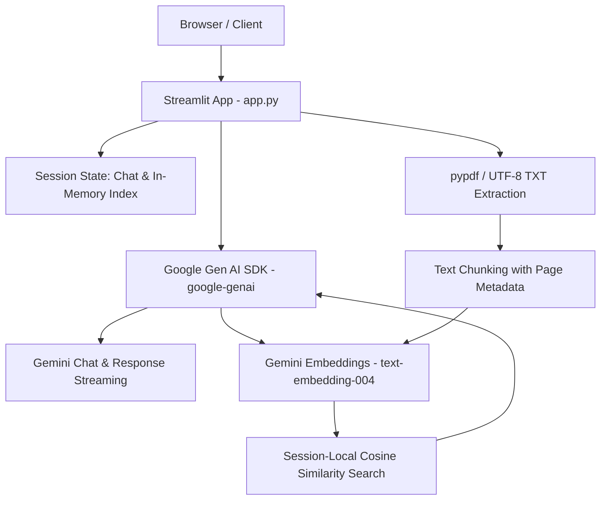

# DATHEON Internship — Task 4: DocuChat AI

DocuChat AI is a production-grade Streamlit application for conversational AI and document-grounded Question Answering (RAG) over user-uploaded PDF and TXT documents. Developed as part of the **DATHEON Internship (Task 4)**, the application interfaces directly with Google's official Gen AI SDK (`google-genai`) for streaming chat generation and semantic embeddings.

The interface is built with an accessible, high-contrast dark navy and electric-blue design system powered by Nunito typography, featuring an intuitive welcome dashboard, a dedicated chat workspace, and a contextual document management panel.

- **Standalone GitHub Repository:** [https://github.com/vinodkumarvr26/DOCUMENT-QA-CHATBOT](https://github.com/vinodkumarvr26/DOCUMENT-QA-CHATBOT)
- **Live Deployment (Render):** [https://document-qa-chatbot-t321.onrender.com](https://document-qa-chatbot-t321.onrender.com)

---

## Features

- **Streamed Multi-Turn Chat:** Gemini 2.5 Flash Lite conversational responses streamed token-by-token with bounded history (up to 20 turns).
- **Session-Isolated RAG:** In-memory vector indexes and document stores isolated strictly per browser session; zero persistence across sessions for privacy.
- **Document Processing & Ingestion:** Supports text-based PDF (via `pypdf`) and UTF-8 TXT files up to 10 MB per file and 5 files per indexing batch.
- **Source-Grounded Answers & Citations:** Explicit source citations with filenames and PDF page numbers; model answers only from retrieved passages with low hallucination temperature (0.2).
- **Refined User Experience:**
  - Role-differentiated chat bubbles (right-aligned electric-blue user bubble; left-aligned elevated dark navy assistant card).
  - Floating chat composer with scroll clearance and fade scrim preventing overlap with long responses or citations.
  - Streamlined document management panel with single-line ellipsis filename truncation and accessible full-name tooltips.
  - Responsive layout optimized for both desktop (1440 × 900) and mobile (390 × 844) viewports.
- **Safe Error Handling:** Graceful user-facing error messages masking internal tracebacks and credentials on rate limits or API outages.

---

## Screenshots

Real browser captures from the responsive Streamlit application:

- [Home dashboard — desktop](screenshots/home-desktop.png)
- [Home dashboard — mobile](screenshots/home-mobile.png)
- [Chat workspace — desktop](screenshots/chat-desktop.png)
- [Chat workspace — mobile](screenshots/chat-mobile.png)
- [Documents workspace — desktop](screenshots/documents-desktop.png)
- [Documents workspace — mobile](screenshots/documents-mobile.png)

Latest Stage 5.5 refinement captures are also preserved in `screenshots/refinement/stage-5-5/`.

---

## Architecture



`st.session_state` owns the active conversation and document vectors. The application does not write temporary files or persist embeddings to disk. Browser session closure or server restart safely purges active indexes.

---

## Technology Stack

- **Python:** 3.13 (`.python-version: 3.13.17`)
- **Frontend Framework:** Streamlit 1.67
- **LLM & Embeddings:** Google Gen AI SDK (`google-genai 3.6.1`)
- **Document Parsing:** `pypdf 7.1.1`
- **Environment Management:** `python-dotenv 1.2.4`
- **Automated Testing:** `pytest 9.2.0` (56 offline tests)
- **Deployment Platform:** Render (Free Web Service)

---

## Project Structure

```text
DATHEON/Task-4/
├── app.py                     # Streamlit frontend & UI layout
├── chatbot/                   # Core business logic & integrations
│   ├── chat_engine.py         # Gemini client factory & model interaction
│   ├── config.py              # Settings & environment configuration
│   ├── conversation_memory.py # Turn-bounded conversation state
│   ├── rag_integration.py     # Document extraction, chunking, & retrieval
│   └── stream_handler.py      # Token streaming for chat & documents
├── tests/                     # 56 unit & integration tests
│   ├── test_app.py
│   ├── test_chat_engine.py
│   ├── test_config.py
│   ├── test_conversation_memory.py
│   ├── test_rag_integration.py
│   └── test_stream_handler.py
├── scripts/                   # Smoke tests & validation utilities
│   ├── gemini_chat_smoke_test.py
│   └── gemini_embedding_smoke_test.py
├── screenshots/               # Verified UI screenshots (desktop & mobile)
│   └── refinement/stage-5-5/  # Stage 5.5 refinement captures
├── .streamlit/                # Streamlit configuration
│   └── config.toml
├── .env.example               # Template environment configuration
├── .gitignore                 # Exclusion rules for secrets & caches
├── .python-version            # Python version pin (3.13.17)
├── render.yaml                # Render Blueprint configuration (plan: free)
├── requirements.txt           # Pinned runtime dependencies
├── requirements-dev.txt       # Development & testing dependencies
└── README.md                  # Task 4 documentation
```

---

## Local Installation & Setup

### 1. Environment Preparation
Use Python 3.13 and create an isolated virtual environment:

```powershell
# Navigate to Task-4
cd Task-4

# Create virtual environment
py -3.13 -m venv .venv

# Activate virtual environment (Windows PowerShell)
.\.venv\Scripts\Activate.ps1

# Upgrade pip & install dependencies
python -m pip install --upgrade pip
python -m pip install -r requirements-dev.txt
```

*(On Linux / macOS: `source .venv/bin/activate`)*

### 2. Environment Variables Configuration
Copy `.env.example` to `.env`:

```powershell
Copy-Item .env.example .env
```

Edit `.env` and supply your Gemini API key:

```env
GEMINI_API_KEY="AIzaSyYourActualKeyHere"
GEMINI_CHAT_MODEL="gemini-3.5-flash-lite"
GEMINI_EMBEDDING_MODEL="gemini-embedding-2"
GEMINI_EMBEDDING_DIMENSIONS="768"
CHAT_HISTORY_LIMIT="20"
CHUNK_SIZE="1000"
CHUNK_OVERLAP="150"
RETRIEVER_TOP_K="4"
```

> **Security Warning:** Never commit `.env` or hardcode API keys. `.gitignore` explicitly excludes `.env`, secrets, and caches.

---

## Running the Application

Launch the Streamlit app locally:

```powershell
streamlit run app.py
```

The application will launch on `http://localhost:8501`.

---

## Document Q&A (RAG) Workflow

1. Navigate to the **Documents** view or use the right-hand **Your documents** panel.
2. Upload one or more `.pdf` or `.txt` files (max 10 MB per file, up to 5 files at a time).
3. Click **Index documents** to process pages, chunk text, and generate embeddings via Gemini.
4. Return to **Chat** and submit questions regarding your documents.
5. DocuChat retrieves the top-4 relevant chunks via cosine similarity, constructs a grounded prompt, streams the answer, and cites exact source files and PDF page numbers.
6. Use **Remove** or **Clear all documents** to discard indexes at any time.

---

## Automated Testing & Verification

The test suite includes 56 tests verifying conversation management, RAG retrieval, citations, UI navigation, and error handling. Tests mock Gemini calls so no external network requests or API costs are incurred.

Run tests:

```powershell
$env:PYTEST_DISABLE_PLUGIN_AUTOLOAD="1"
pytest -v
```

All 56 tests pass with 100% test success.

---

## Standalone Deployment

The standalone project is deployed on Render using a Free instance plan:
- **Blueprint file:** `render.yaml` (`plan: free`)
- **Health check endpoint:** `/_stcore/health`
- **Public URL:** [https://document-qa-chatbot-t321.onrender.com](https://document-qa-chatbot-t321.onrender.com)

---

## Known Limitations

- **OCR:** Scanned/image-only PDFs without an extractable text layer are rejected; OCR is not supported.
- **Session Scope:** Indexes and conversations are strictly in-memory and discarded upon browser session termination or server reboot.
- **Render Free Tier Spin-Down:** Free instances spin down after 15 minutes of inactivity, requiring ~50–90 seconds to wake on initial access.
